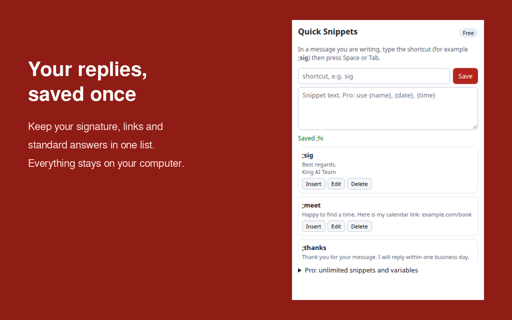
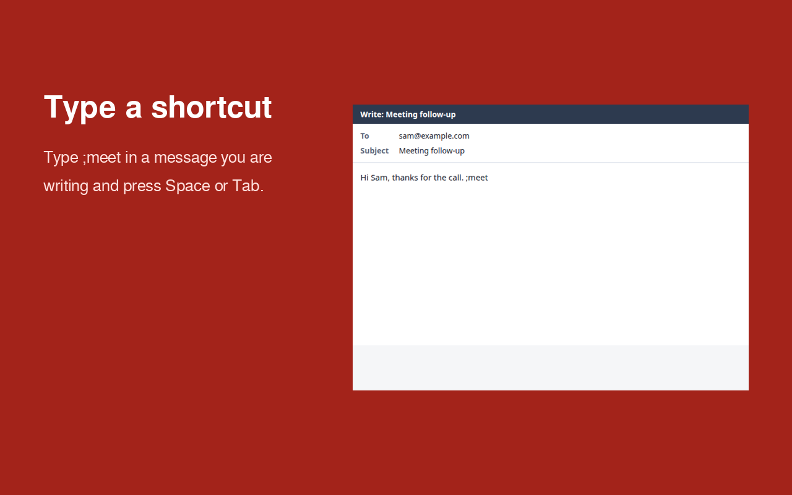
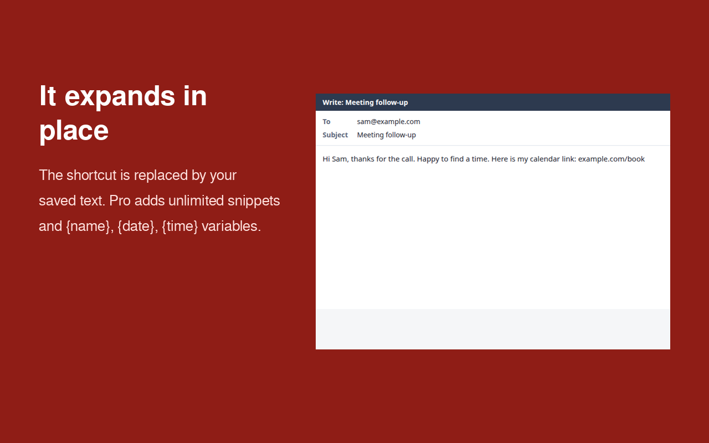

# Quick Snippets for Thunderbird

Type a shortcut like `;sig`, press Space or Tab, and your saved reply replaces it in the Thunderbird message window. Not affiliated with Mozilla or Thunderbird.

Also available for Gmail in Firefox: https://github.com/kingworks-dev/snippets-for-gmail

## What it does
- Type a shortcut then Space or Tab to insert saved text in the message you are writing
- Toolbar popup in the compose window to add, edit, delete and insert multi-line snippets
- Free keeps 10 snippets

## Data and privacy
No accounts, servers or analytics, no network requests. Snippets, the {name} value and your Pro key are kept in `storage.local` on your computer. A script in the message editor watches typing only to spot a shortcut; it does not read or send your email. Permissions: `storage`, `compose`.

See [PRIVACY.md](PRIVACY.md).

## Free and Pro
Free as described above. An optional Pro unlock is a one-time $4.99 payment (no subscription): Pro adds unlimited snippets and the variables {name}, {date} and {time}. Buy: https://buy.stripe.com/6oUeV6bTNb4E5Zw86D0x40Z ; the key is on the confirmation page. The key is checked on your device.

## Screenshots

## Load from source
In Thunderbird 140 or newer open Tools > Developer Tools > Debug Add-ons > Load Temporary Add-on and pick `src/manifest.json`.

(c) KING HOLDINGS VENTURES LLC (King AI). Source published for transparency; all rights reserved. Contact: hello@usekingai.com
